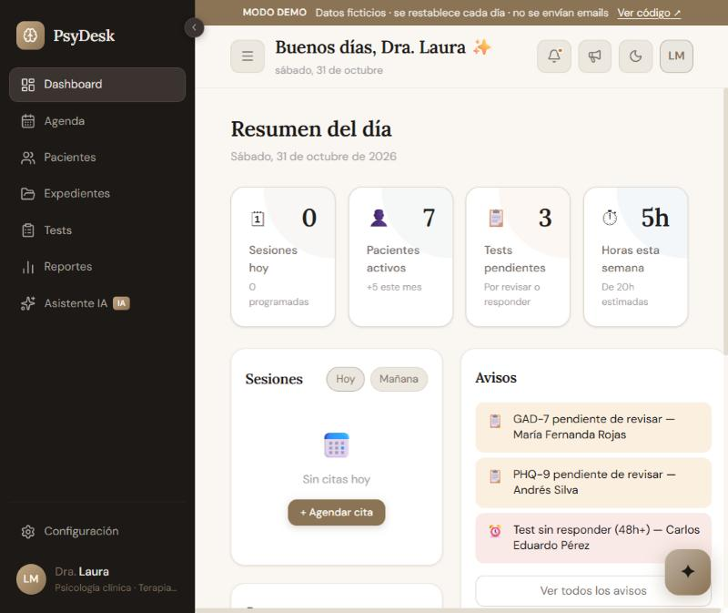
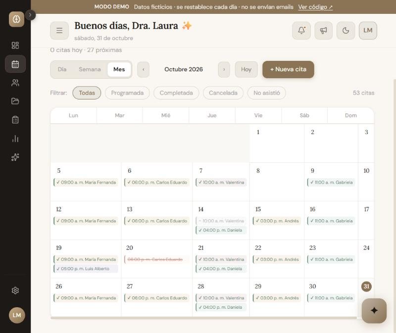
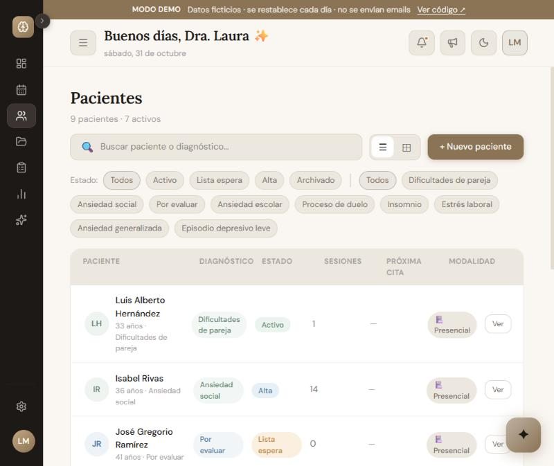
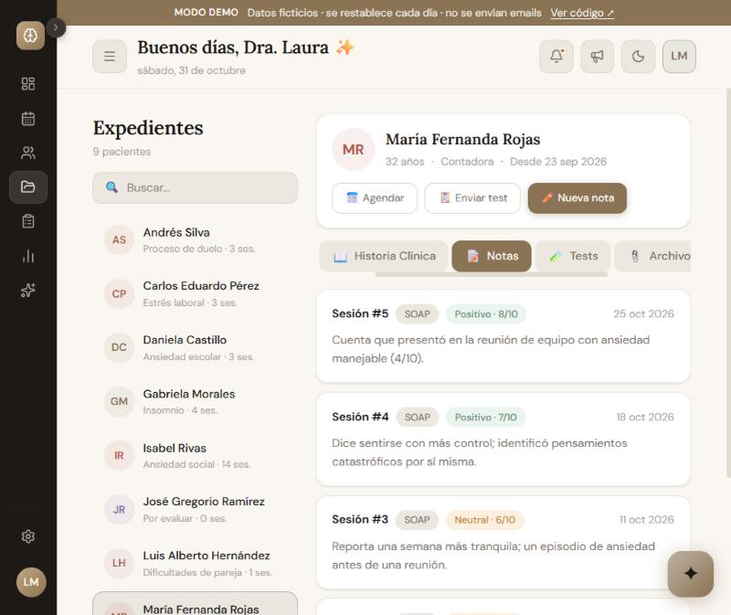
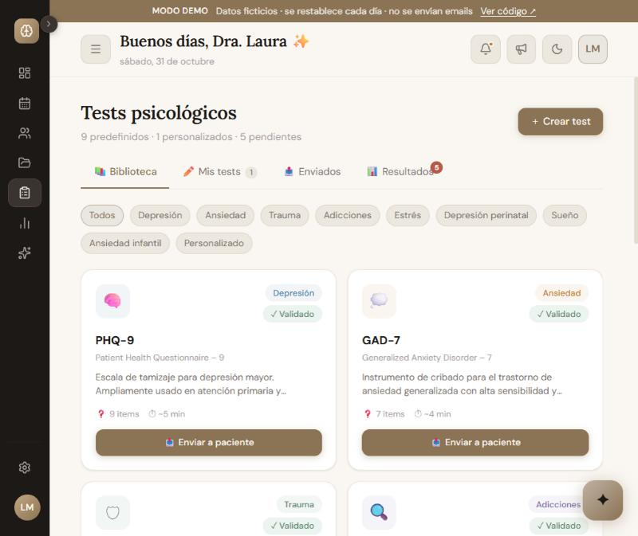
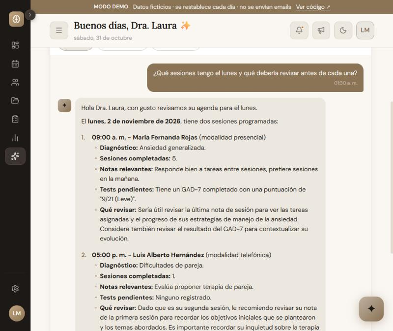
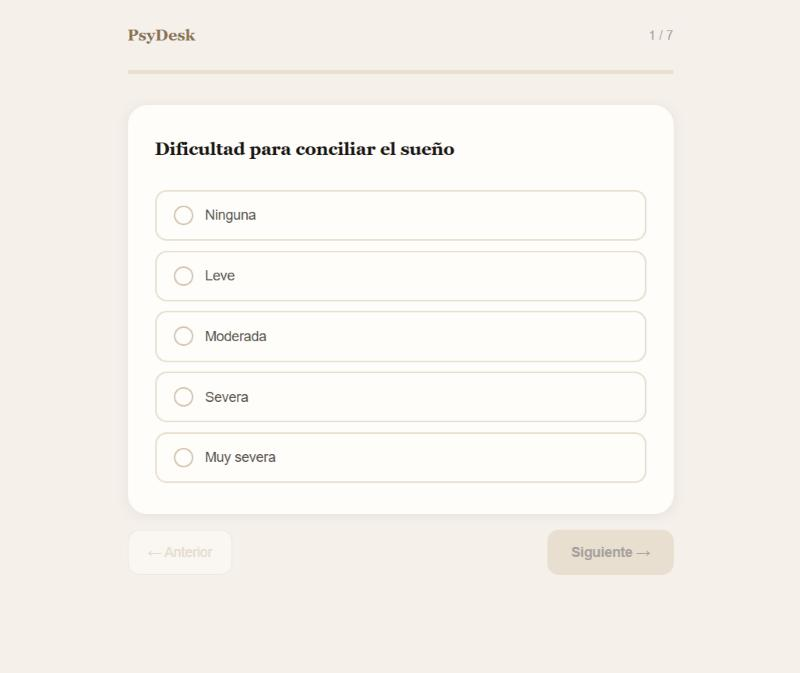

# PsyDesk

**[Español](#español) · [English](#english)**

> 🔗 **Demo:** [psydesk.vercel.app/login?demo=1](https://psydesk.vercel.app/login?demo=1). Entra con un clic, sin registrarte / one click, no sign-up.
> Datos 100 % ficticios, se restablecen cada noche / 100 % fictional data, reset nightly.



<table>
  <tr>
    <td width="50%"><br><sub><b>Agenda</b> · vista mensual con estados de cita / monthly view with appointment statuses</sub></td>
    <td width="50%"><br><sub><b>Pacientes</b> · filtros por estado y diagnóstico / filters by status and diagnosis</sub></td>
  </tr>
  <tr>
    <td><br><sub><b>Expediente</b> · notas SOAP con registro de ánimo / SOAP notes with mood tracking</sub></td>
    <td><br><sub><b>Tests</b> · instrumentos validados y tests propios / validated instruments and custom tests</sub></td>
  </tr>
  <tr>
    <td><br><sub><b>Asistente IA</b> · responde con los datos reales de la agenda / answers from real schedule data</sub></td>
    <td><br><sub><b>Cuestionario</b> · el paciente responde sin cuenta / patients answer without an account</sub></td>
  </tr>
</table>

---

## Español

PsyDesk es una plataforma de gestión clínica para psicólogos: agenda, pacientes, expedientes, tests psicométricos y un asistente con IA. Todo vive en un solo panel web.

### Funcionalidades

| Módulo | Qué hace |
|---|---|
| **Agenda** | Citas por día y semana, con estados (programada, completada, cancelada, no asistió), modalidad presencial, videollamada o teléfono, y sincronización opcional con Google Calendar. |
| **Pacientes** | Alta de pacientes, estados (activo, lista de espera, alta, archivado), datos de contacto y diagnóstico. |
| **Expedientes** | Historia clínica completa (incluye desarrollo infantil para pacientes menores), notas de sesión en formato SOAP con dictado por voz, registro de ánimo y archivos adjuntos. |
| **Tests** | 9 instrumentos validados (PHQ-9, GAD-7, PCL-5, AUDIT, ISI, PSS-10…) con puntaje automático y un constructor de tests propios. El paciente los responde desde un enlace público con token. |
| **Asistente IA** | Chat con Gemini que conoce la agenda y los pacientes del profesional, para preguntas como "¿qué tengo mañana?" o "resúmeme a este paciente". |
| **Reportes** | Métricas de la consulta. |
| **Cuenta** | Login con email o Google, recuperación de contraseña, cierre de sesión automático por inactividad, sesiones activas, tema claro/oscuro y preferencias. |
| **Feedback** | Formulario de reportes y sugerencias con captura de pantalla, más un panel de administración. |

### Stack

- **Next.js 16** (App Router) · **React 19** · **TypeScript**
- **Supabase**: Postgres, Auth (email + Google OAuth), Storage
- **Tailwind CSS 4** · **shadcn/ui** · Zustand · React Hook Form + Zod
- **Gemini 2.5 Flash** para el asistente · **Resend** para emails · **Google Calendar API**
- Deploy en **Vercel**, con Vercel Cron para el reset diario de la demo

### Arquitectura y decisiones

- **Rutas protegidas en el middleware**: cada request valida la sesión de Supabase con `@supabase/ssr` y redirige según el estado.
- **API con identidad del servidor**: las rutas `/api/*` obtienen el usuario de la cookie de sesión (`lib/auth/session.ts`), nunca del body, y verifican que el paciente o la cita pertenezcan al profesional antes de leer o escribir con la service role.
- **Cuestionarios por token**: el paciente responde sin cuenta, mediante un enlace único. La página nunca consulta la base directamente: `/api/cuestionario/[token]` devuelve solo ese test, valida las respuestas, calcula el puntaje en el servidor y acepta un único envío.
- **Row Level Security**: cada profesional solo ve sus propias filas (`psychologist_id = auth.uid()`), y el rol anónimo no tiene acceso a ninguna tabla clínica.
- **Privacidad**: la página pública [`/seguridad`](https://psydesk.vercel.app/seguridad) explica dónde están los datos, quién puede verlos, qué se comparte con servicios externos y cómo se borran.
- **Modo demo**: una cuenta pública (`lib/demo.ts`) sin emails, sin integraciones externas y con límite de uso de la IA. `/api/demo/reset` la regenera cada noche con datos ficticios y fechas relativas a hoy, para que la agenda siempre se vea activa (`lib/demo-seed.ts`).

### Correr en local

```bash
pnpm install
cp .env.example .env.local   # completar con tus claves
pnpm dev
```

Para generar la cuenta demo en local:

```bash
curl -H "Authorization: Bearer $CRON_SECRET" http://localhost:3000/api/demo/reset
```

---

## English

PsyDesk is a practice-management platform for psychologists: scheduling, patients, clinical records, psychometric tests and an AI assistant, all in one web dashboard.

### Features

| Module | What it does |
|---|---|
| **Schedule** | Daily and weekly appointments with statuses (scheduled, completed, cancelled, no-show), in-person, video or phone sessions, and optional Google Calendar sync. |
| **Patients** | Patient intake, statuses (active, waitlist, discharged, archived), contact info and diagnosis. |
| **Clinical records** | Full clinical history (including developmental history for minors), SOAP session notes with voice dictation, mood tracking and file attachments. |
| **Tests** | 9 validated instruments (PHQ-9, GAD-7, PCL-5, AUDIT, ISI, PSS-10…) with automatic scoring, plus a custom test builder. Patients answer through a public, token-based link. |
| **AI assistant** | Gemini-powered chat that knows the clinician's schedule and patients, for questions like "what do I have tomorrow?" or "summarize this patient". |
| **Reports** | Practice metrics. |
| **Account** | Email or Google sign-in, password recovery, inactivity auto-logout, active sessions, light/dark theme and preferences. |
| **Feedback** | Bug/suggestion form with screenshots, plus an admin panel. |

### Tech stack

- **Next.js 16** (App Router) · **React 19** · **TypeScript**
- **Supabase**: Postgres, Auth (email + Google OAuth), Storage
- **Tailwind CSS 4** · **shadcn/ui** · Zustand · React Hook Form + Zod
- **Gemini 2.5 Flash** for the assistant · **Resend** for email · **Google Calendar API**
- Deployed on **Vercel**, with Vercel Cron for the nightly demo reset

### Architecture notes

- **Middleware-protected routes**: every request validates the Supabase session with `@supabase/ssr` and redirects accordingly.
- **Server-side identity in the API**: `/api/*` routes read the user from the session cookie (`lib/auth/session.ts`), never from the request body, and check that the patient or appointment belongs to the clinician before using the service role.
- **Token-based questionnaires**: patients answer without an account, through a unique link. The page never queries the database directly: `/api/cuestionario/[token]` returns only that test, validates the answers, scores them server-side and accepts a single submission.
- **Row Level Security**: each clinician only sees their own rows (`psychologist_id = auth.uid()`), and the anonymous role has no access to any clinical table.
- **Privacy**: the public page [`/seguridad`](https://psydesk.vercel.app/seguridad) (Spanish) explains where data lives, who can see it, what is shared with third parties and how it is deleted.
- **Demo mode**: a public account (`lib/demo.ts`) with no outgoing email, no third-party integrations and a capped AI quota. `/api/demo/reset` rebuilds it nightly with fictional data and dates relative to today, so the schedule always looks active (`lib/demo-seed.ts`).

### Run locally

```bash
pnpm install
cp .env.example .env.local   # fill in your keys
pnpm dev
```

Seed the demo account locally:

```bash
curl -H "Authorization: Bearer $CRON_SECRET" http://localhost:3000/api/demo/reset
```

---

Hecho por / Built by **Jose Torres** · [GitHub](https://github.com/xTorres97)
